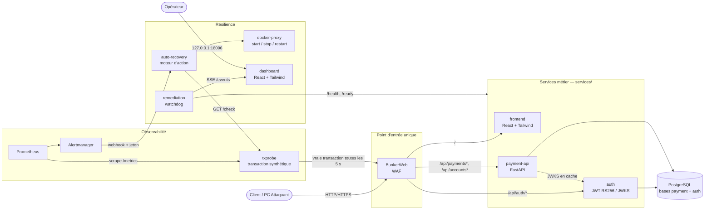
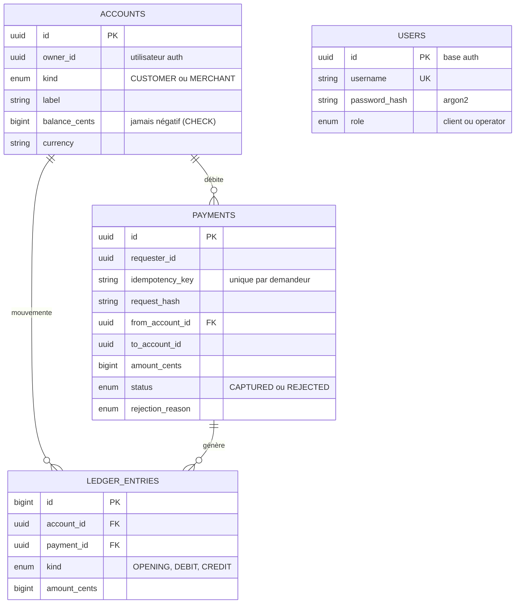
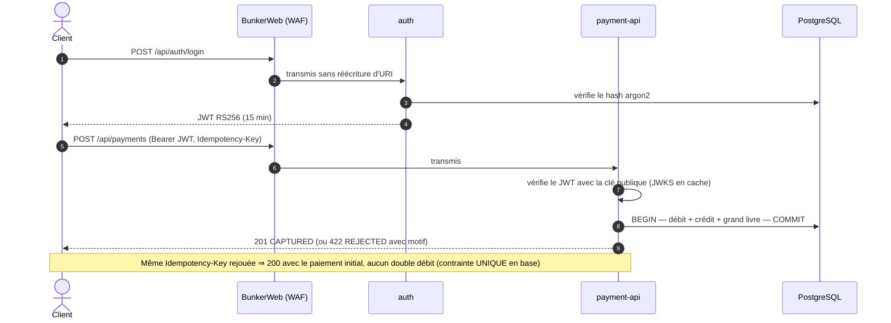
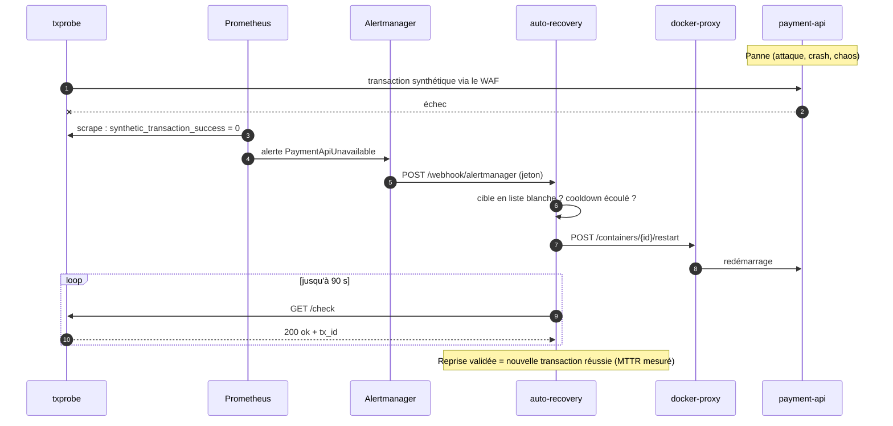
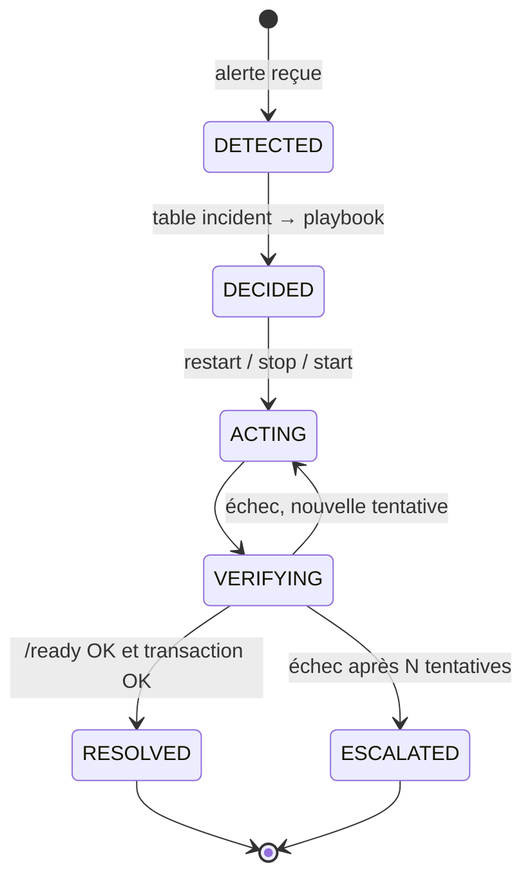

# PROJECT RESILIENCE-ALPHA

Démonstrateur de **cyber-résilience** (Workshop EPSI Bac+5, octobre 2026). Une plateforme de paiement
**fictive** subit une attaque. Le système détecte l'anomalie, se répare **sans intervention humaine**, puis
prouve la reprise par une **nouvelle transaction réussie**, le tout observé (Prometheus / Grafana / Loki)
et protégé par un WAF (BunkerWeb) + SIEM (Wazuh). Un **module IA (SOC)** repère ce que le WAF laisse
passer et fait rédiger par un LLM des règles de protection, relues par un humain (jamais appliquées seules).

> Aucune donnée bancaire réelle · aucune action offensive hors de notre SI · aucun secret dans le dépôt.

## Équipe — groupe 2

| Membre | Domaine |
|---|---|
| ATTISSO Rudolph | Développement (EISI dev) |
| BOZZANI Arman | Infrastructure (EISI infra) |
| TRAN HUU Tri Quentin | IA / Data |
| GARCIA Robin | Cybersécurité |
| BREMARD Thomas | Cybersécurité |

## Organisation du dépôt

```
docker-compose.yml        Définition de toute la plateforme (réseaux, secrets, services)
.env.example              Paramètres non secrets (ports, WAF, remédiation)
scripts/ops.ps1|ops.sh    Point d'entrée des opérations (lance Ansible en conteneur)
ansible/                  Runner, inventaire, playbooks (deploy, verify, backup, restore, recover, chaos…)
infra/                    Configs : postgres, prometheus, alertmanager, loki, alloy, grafana, blackbox, docker-proxy, wazuh, vault
├── ml-detector/          IA : détecteur ML (tourne dans ce compose, sur le PC Hôte)
services/                 Dev : microservices Python/FastAPI, front et dashboard React + Tailwind
ai/                       IA : nœud LLM du PC IA (llm-gateway + Ollama + ChromaDB), compose séparé
contracts/                Contrats entre domaines (OpenAPI, format d'alerte, conventions de service)
attack/                   Banc d'attaque de démo (DDoS, XSS) — à lancer depuis le PC Attaquant
docs/
├── adr/                  Décisions techniques (ADR-<DOMAINE>-NNNN), index dans docs/adr/README.md
├── ia/                   Module IA SOC : vue d'ensemble, intégration, déploiement du PC IA
└── progression/          Journal de chaque domaine (matière du dossier PDF)
CLAUDE.md                 Règles communes de l'équipe
secrets/ backups/ reports/ exports/   Données locales (non versionnées)
```

## Application — `services/` (domaine Dev)

Portefeuille de paiement **fictif** (clients → marchands) en microservices Python 3.12 / FastAPI, avec deux
interfaces React + Tailwind. Tous les services Python partagent le socle `services/common` : logs JSON sur stdout
(`timestamp`, `level`, `service`, `trace_id`, `event`), `/health` · `/ready` · `/metrics`, erreurs RFC 9457.

| Composant | Dossier | Service Compose | Rôle | Exposition |
|---|---|---|---|---|
| Frontal client | `services/web/` | `frontend` | React + Tailwind servi par nginx non-root : connexion, solde, paiement, historique | via le WAF (`/`) |
| Authentification | `services/auth/` | `auth` | Connexion, jetons JWT **RS256** de 15 min, clé publique en JWKS, mots de passe argon2 | via le WAF (`/api/auth/*`) |
| API de paiement | `services/payment-api/` | `payment-api` | Comptes, paiements synchrones et idempotents (`Idempotency-Key`), grand livre | via le WAF (`/api/payments*`, `/api/accounts*`) |
| Transaction synthétique | `services/smoke-test/` | `txprobe` | Vraie transaction de 1 centime **à travers le WAF** toutes les 5 s + `GET /check` à la demande : **preuve de reprise** | réseau interne |
| Supervision Dev | `services/remediation/` | `remediation` | Watchdog : état des services et de leurs connexions toutes les 5 s (`GET /services`, flux SSE `/events`) | `127.0.0.1:18090` |
| Dashboard opérateur | `services/dashboard/` | `dashboard` | Carte des services, détail, journal des changements, pop-ups d'alerte (compte `operator`) | `127.0.0.1:18096` |
| Moteur d'action | `services/auto-recovery/` | `auto-recovery` | Reçoit les alertes Alertmanager (`POST /webhook/alertmanager`, jeton), redémarre la cible via le docker-proxy, puis valide par une transaction synthétique | `127.0.0.1:18095` |
| Collecte de logs SIEM | `services/logshipper/` | `logshipper` | Recopie les logs des conteneurs (proxy Docker en lecture seule) vers l'agent Wazuh | aucune |
| Socle commun | `services/common/` | — | Package `resilience_common` : `create_app`, logs, trace_id, sondes, métriques, vérification JWT | — |

### Vue d'ensemble



### Modèle de données

PostgreSQL (conteneur et sauvegardes : Infra ; schéma et migrations Alembic : Dev), une base par service
avec un utilisateur dédié. Aucune clé étrangère entre les deux bases : `owner_id` / `requester_id` portent
l'identifiant de l'utilisateur lu dans le JWT.



### Parcours d'un paiement



Le `trace_id` (en-tête `X-Trace-Id`) suit la requête dans les logs de tous les services, donc dans Loki.
La clé JWKS étant en cache, une panne de `auth` n'interrompt pas les paiements des clients déjà connectés.

### Boucle de résilience (sans intervention humaine)



Cycle de vie d'un incident visé par le moteur (contrat `contracts/openapi-remediation.yaml`) :



En parallèle, le watchdog `remediation` interroge chaque service toutes les 5 s et pousse les changements d'état
au `dashboard` par SSE : c'est la vue temps réel pour l'opérateur et le jury.

Garde-fous du moteur d'action : liste blanche des cibles (`bunkerweb`, `frontend`, `auth`, `payment-api`,
`postgres`, `vault`), cooldown par cible contre les boucles de redémarrage, aucun accès direct au socket Docker
(proxy limité à lecture + `start`/`stop`/`restart`). Un conteneur redémarré ne suffit pas : la reprise n'est
déclarée que lorsqu'une **nouvelle transaction réussit** à travers le WAF.

> `remediation` (supervision Dev) et `auto-recovery` (action) sont aujourd'hui deux services ; ils seront fusionnés
> quand le watchdog déclenchera lui-même les playbooks (voir ADR-DEV-0004 et ADR-DEV-0006).

### Choix techniques du Dev

| Sujet | Choix | ADR |
|---|---|---|
| Stack | Python 3.12 + FastAPI + Uvicorn, SQLAlchemy 2 + Alembic, Vite + React + Tailwind, pytest / Vitest | [ADR-DEV-0001](docs/adr/ADR-DEV-0001-stack-dev.md) |
| Paiement | Synchrone, une seule transaction SQL, idempotent | [ADR-DEV-0002](docs/adr/ADR-DEV-0002-paiement-synchrone-idempotent.md) |
| Authentification | JWT RS256 + JWKS ; clé éphémère ⇒ redémarrer `auth` révoque tous les jetons (levier de remédiation) | [ADR-DEV-0003](docs/adr/ADR-DEV-0003-auth-jwt-rs256-jwks.md) |
| Contrats de remédiation | Format d'alerte et API du moteur | [ADR-DEV-0004](docs/adr/ADR-DEV-0004-contrats-remediation.md) |
| Intégration plateforme | Routes publiques `/api/...` (le WAF ne réécrit pas l'URI), secrets `<NOM>_FILE` montés depuis Vault | [ADR-DEV-0005](docs/adr/ADR-DEV-0005-integration-plateforme-infra.md) |
| Supervision | Topologie des services et de leurs connexions, diffusée en SSE | [ADR-DEV-0006](docs/adr/ADR-DEV-0006-supervision-topologie.md) |

### Tests du Dev

```bash
cd services
python -m venv .venv && .venv/Scripts/python -m pip install -r requirements-dev.txt
docker compose -f compose.dev.yml --env-file .env up -d --wait   # bases de test locales (5433, 5434)
set -a && . ./.env && set +a
.venv/Scripts/python -m pytest common/tests
(cd payment-api && ../.venv/Scripts/python -m pytest)            # idem pour auth, smoke-test, remediation
(cd web && npm install && npm test)                             # idem pour dashboard
```

⚠️ Les tests **vident** les bases pointées par `DATABASE_URL` / `AUTH_DATABASE_URL` : ne jamais les lancer contre
la plateforme de démo. Détail complet dans [services/README.md](services/README.md).

---

## 1. Prérequis (PC Hôte)

| Élément | Minimum | Remarque |
|---|---|---|
| OS | Windows 10/11 (ou Linux) | droits admin, virtualisation activée |
| Docker Desktop | 4.x avec backend **WSL2**, Compose ≥ 2.20 | **seule** dépendance à installer |
| Mémoire allouée à Docker | 4 Go (6–8 Go conseillés) | la stack consomme ~2,5 Go au repos |
| Disque | 10 Go libres | images + volumes |

**Rien d'autre à installer** : Ansible tourne dans un conteneur (`ansible/Dockerfile`),
construit automatiquement au premier lancement.

## 2. Démarrage rapide (plateforme complète)

```powershell
git clone <url-du-depot> ; cd <depot>
git checkout develop                  # branche d'intégration de l'équipe
.\scripts\ops.ps1 deploy              # Windows PowerShell
```
```bash
./scripts/ops.sh deploy               # Linux, WSL ou Git Bash
```

Le playbook `deploy` :
1. vérifie Docker (version, mémoire) et crée `.env` depuis `.env.example` si absent ;
2. **génère les secrets manquants** dans `secrets/` (jamais versionnés, jamais écrasés) ;
3. valide la configuration (`docker compose config`, `promtool`, `amtool`) ;
4. construit les images applicatives et démarre la stack en attendant les healthchecks ;
5. **vérifie fonctionnellement** la plateforme : transaction de paiement réelle via le WAF,
   cibles Prometheus, arrivée des logs dans Loki, sonde synthétique, moteur de remédiation.

Durée : ~5 min au premier lancement (téléchargement des images), < 1 min ensuite.

### Lancer uniquement l'application (sans la plateforme Infra)

Pour développer sur les services sans monter tout BunkerWeb/Vault/Wazuh, `services/compose.dev.yml`
lance l'application seule avec une passerelle nginx qui **imite** le WAF — voir `services/README.md`
pour le détail (ports, comptes de démo, tests automatisés).

## 3. Accès

| Interface | URL | Exposition |
|---|---|---|
| Application (via WAF BunkerWeb) | `http://<IP-hote>/` ou `https://<IP-hote>/` (certificat auto-signé : avertissement navigateur normal) | réseau du hotspot |
| Dashboard de supervision | http://127.0.0.1:18096 (ou port défini par `DASHBOARD_PORT`) — compte `operator` | local uniquement |
| Grafana | http://127.0.0.1:3000 — dashboard *Resilience-Alpha* (métriques, logs, alertes, section SIEM Wazuh) | local uniquement |
| Vault (secrets) | http://127.0.0.1:18200 — jeton : `docker exec resilience-vault-unsealer-1 cat /vault/keys/root_token` | local uniquement |
| Console BunkerWeb (GUI du WAF) | http://127.0.0.1:17000 — utilisateur `admin`, mot de passe : valeur `BW_UI_PASSWORD` du fichier `.env` | local uniquement |
| Prometheus | http://127.0.0.1:9090 | local uniquement |
| Alertmanager | http://127.0.0.1:9093 | local uniquement |
| Supervision Dev (watchdog) | http://127.0.0.1:18090/services · flux SSE `/events` | local uniquement |
| Moteur d'action (`auto-recovery`) | http://127.0.0.1:18095/events — journal des remédiations | local uniquement |

Identifiants : `type secrets\grafana_admin_password` (Grafana `admin`), `type secrets\demo_user_password`
(utilisateurs fictifs `alice`/`bob`/`cafe-demo`), `type secrets\operator_password` (dashboard, `operator`). Wazuh n'a pas d'interface propre : ses alertes sont dans
Grafana. La base de données, Loki, Wazuh, les exporters et les proxies Docker ne sont **jamais** publiés.

## 4. Opérations courantes

Toutes les opérations passent par **un seul point d'entrée** : `scripts/ops.ps1 <action>`
(ou `scripts/ops.sh`). Chaque action est un playbook Ansible de `ansible/playbooks/`.

| Action | Rôle | Exemple |
|---|---|---|
| `deploy` | installation / mise à jour idempotente + vérification | `.\scripts\ops.ps1 deploy` |
| `verify` | contrôle de santé fonctionnel (avant la démo !) | `.\scripts\ops.ps1 verify` |
| `backup` | sauvegarde base horodatée + SHA-256 + rotation | `.\scripts\ops.ps1 backup` |
| `restore` | restauration (dernière sauvegarde par défaut) | `.\scripts\ops.ps1 restore -e restore_file=payments-…dump` |
| `recover` | **PRA** : reconstruction depuis les sources (compromission) | `.\scripts\ops.ps1 recover -e wipe_data=true` |
| `chaos` | recette : injecte une panne et mesure MTTD/MTTR | `.\scripts\ops.ps1 chaos -e target=auth -e fault=kill` |
| `reload` | rechargement des configs d'observabilité | `.\scripts\ops.ps1 reload` |
| `teardown` | arrêt (`-e purge=true` supprime aussi les données) | `.\scripts\ops.ps1 teardown` |

Relance après redémarrage du PC : démarrer Docker Desktop puis lancer `.\scripts\ops.ps1 deploy`
(idempotent, ~1 min). Ne pas compter sur `restart: unless-stopped` : quand Docker Desktop est quitté
proprement, les conteneurs sont arrêtés et ne repartent PAS tout seuls (constaté). La politique ne
joue que pour un plantage d'un conteneur.

## 5. Démos

**Reprise automatique (panne de service)** :
```powershell
.\scripts\ops.ps1 chaos                       # arrête payment-api et chronomètre la reprise
```
Dans Grafana : la transaction synthétique passe au rouge, l'alerte `PaymentApiUnavailable`
se déclenche, le moteur redémarre le service, puis la transaction repasse au vert.
Le rapport JSON (temps de détection / de reprise) est écrit dans `reports/`.

**Attaque DDoS + XSS (depuis le PC Attaquant)** — voir [attack/README.md](attack/README.md) :
```bash
DEMO_PASSWORD=<mdp alice> ./attack/run_demo.sh http://192.168.137.1
```
Le WAF BunkerWeb bloque les XSS/SQLi (403) et bannit l'IP qui inonde (DDoS) ; **Wazuh** lève les
alertes correspondantes, **visibles dans Grafana** (section « SIEM Wazuh » + alertes Alertmanager) avec
le pic et les blocages, et la transaction synthétique interne reste verte : le service tient.

**Module IA SOC (détection + reprise sous charge)** — procédure détaillée (brancher le PC IA, relâcher
le WAF, surcharge calibrée) dans [docs/ia/README.md](docs/ia/README.md). Sur la **vue d'ensemble**
Grafana, la courbe « Module IA — gravité détectée » monte, puis une annotation marque l'escalade et le
rapport du LLM (diagnostic + règles proposées dans l'infobulle), pendant que la reprise automatique
redémarre le service.

## 6. Documentation

| Sujet | Où |
|---|---|
| Architecture infra, rôle de Compose / Ansible / observabilité, réseau, sécurité | [docs/INFRA.md](docs/INFRA.md) |
| Schéma d'architecture, matrice de flux, inventaire | [docs/diagrams/architecture.drawio](docs/diagrams/architecture.drawio) |
| Procédures d'exploitation et de reprise (PRA) | [docs/RUNBOOK.md](docs/RUNBOOK.md) · [docs/PCA-PRA.md](docs/PCA-PRA.md) |
| Contrats pour les pôles DEV, IA et Cyber | [docs/INTEGRATION.md](docs/INTEGRATION.md) |
| API de paiement et d'authentification (OpenAPI) | `contracts/openapi-payment.yaml` |
| API du moteur de remédiation (OpenAPI) | `contracts/openapi-remediation.yaml` |
| Format des alertes (IA, Prometheus, WAF → moteur) | `contracts/alert.schema.json` |
| Conventions de tout service (`/health`, `/ready`, `/metrics`, logs JSON) | `contracts/service-conventions.md` |
| Détail des services Dev (développement sans Docker, routes, jetons) | `services/README.md` |
| **Module IA SOC : vue d'ensemble, tests, comment le lancer** | [docs/ia/README.md](docs/ia/README.md) |
| Module IA : intégration à la plateforme (compose, Prometheus, Grafana, métrique) | [docs/ia/INTEGRATION.md](docs/ia/INTEGRATION.md) |
| Module IA : déploiement du PC IA (Ollama, gateway, modèles) | [docs/ia/DEPLOIEMENT-PC-IA.md](docs/ia/DEPLOIEMENT-PC-IA.md) |
| Décisions techniques | `docs/adr/README.md` |
| Avancement par domaine | `docs/progression/` |

Les contrats s'ouvrent aussi dans https://editor.swagger.io (Fichier → Importer).

## 7. Dépannage rapide

| Symptôme | Cause probable | Action |
|---|---|---|
| `Docker n'est pas joignable` | Docker Desktop arrêté | le lancer, attendre « Engine running » |
| port 80 déjà utilisé | IIS / autre serveur web | `PUBLIC_HTTP_PORT=8080` dans `.env`, puis `deploy` |
| `verify` : logs Loki KO juste après le déploiement | Alloy démarre | relancer `verify` 30 s plus tard |
| mots de passe refusés après rotation des secrets | la base garde les anciens | `recover -e wipe_data=true` |
| PC Attaquant ne joint pas l'hôte | pare-feu Windows | autoriser le port 80 entrant sur le profil du hotspot |

## 8. Règles de contribution

- Branches `<domaine>/<sujet>` (ex. `dev/payment-api`, `infra/loki`), PR vers `develop`. `main` doit toujours démarrer.
- Commits au format `<domaine>: <action>` (ex. `dev: ajoute endpoint POST /payments`).
- Chaque domaine ne modifie que son dossier. `contracts/`, `docs/`, `CLAUDE.md` et ce README sont communs :
  toute modification passe par une PR.
- Détails dans `CLAUDE.md`.

Toutes les données sont **fictives**. Aucune donnée bancaire réelle ne doit être utilisée.
