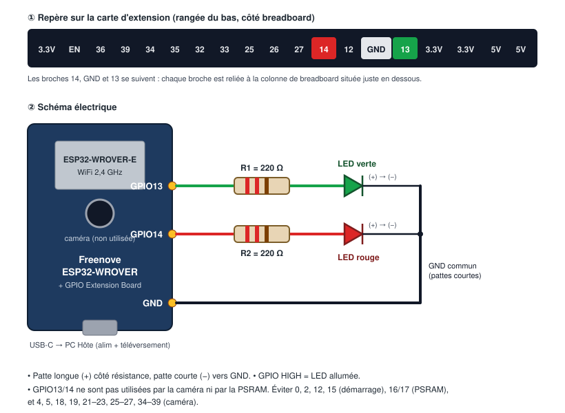
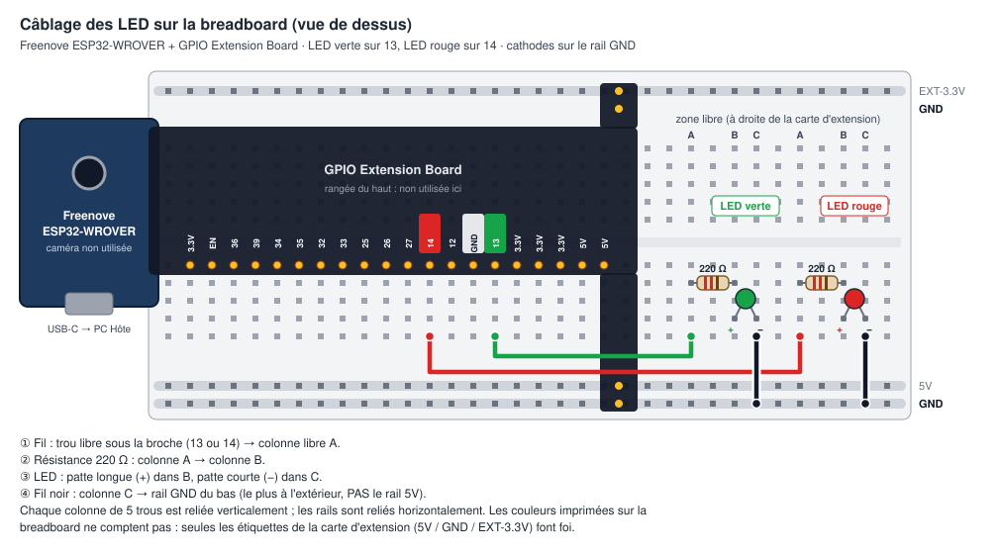
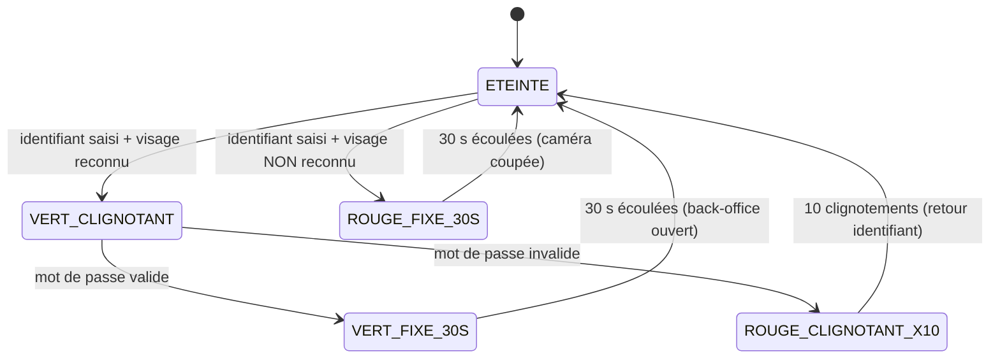
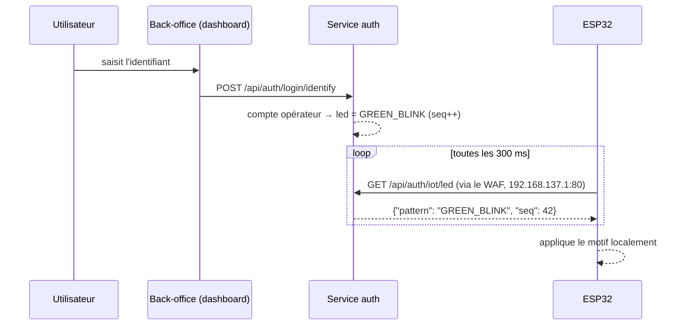

# Objet connecté — LED de statut d'authentification (ESP32)

> Source : *Workshop 2026-27 M2 — Consigne Additionnelle 1* (`private/`).
> Statut : **implémenté** côté Dev (service `auth`, dashboard, firmware). Contrat : `contracts/openapi-payment.yaml`
> (routes `/api/auth/login/identify` et `/api/auth/iot/led`). La caméra et la reconnaissance faciale ne sont
> **pas livrées** : « reconnu » signifie « identifiant d'un compte opérateur existant » (§ 5.3).

---

## 1. Ce que demande la consigne et ce que nous utilisons

| Exigence | Consigne | Démo du groupe |
|----------|----------|----------------|
| Microcontrôleur | ESP8266 | **Freenove ESP32-WROVER CAM** + carte d'extension GPIO (matériel disponible) |
| IDE | **JetBrains CLion + PlatformIO** (obligatoire) | **Arduino IDE** (choix du groupe, voir l'avertissement) |
| Actionneur | LED bicolore rouge/vert | **2 LED** (une verte, une rouge) : même rendu |
| Réseau | WiFi sur le point d'accès `RESILIENCE-G<n>` | idem |
| Caméra de reconnaissance | **USB, branchée sur le PC Hôte** | idem : la caméra de la carte ESP32 **n'est pas utilisée** |

> ⚠️ **Écarts à assumer devant le jury** : l'ESP32 remplace l'ESP8266 (il est plus puissant et offre la même
> API WiFi/Arduino, donc la logique reste identique) et deux LED remplacent la LED bicolore. La caméra
> intégrée à la carte ESP32 ne doit **pas** servir à la reconnaissance faciale, car la consigne impose une
> caméra USB sur le PC Hôte.
>
> ⚠️ **IDE : écart assumé.** La consigne impose CLion + PlatformIO, mais le groupe développe sous **Arduino IDE**.
> Argument pour le jury : PlatformIO utilise le même framework Arduino, donc le sketch se porte tel quel
> (`.ino` → `src/main.cpp` + `#include <Arduino.h>`). Ce portage reste possible si le jury l'exige.

## 2. Matériel

| Qté | Composant | Remarque |
|-----|-----------|----------|
| 1 | **Freenove ESP32-WROVER CAM** (module ESP32-WROVER-E) | port **USB-C** intégré : pas d'adaptateur FTDI |
| 1 | **Freenove ESP32 GPIO Extension Board** | à cheval sur la breadboard, reporte chaque GPIO sur une colonne |
| 1 | Breadboard | |
| 1 | LED **verte** + 1 LED **rouge** | |
| 2 | Résistances **220 Ω** (rouge-rouge-marron) | 100 Ω à 1 kΩ acceptables |
| 3 | Fils Dupont mâle-mâle (ou pattes de composants directement) | |
| 1 | Câble **USB-C avec données** | alimentation + téléversement depuis le PC Hôte |

## 3. Câblage



### 3.1 Table de câblage

| Broche (carte d'extension) | → | Composant |
|----------------------------|---|-----------|
| `13` | R1 220 Ω → | patte longue (+) de la LED **verte** |
| `14` | R2 220 Ω → | patte longue (+) de la LED **rouge** |
| `GND` (entre `12` et `13`) | → | pattes courtes (−) des deux LED |

```
 Carte d'extension (rangée du bas) :  … 27  [14]  12  [GND]  [13]  3.3V …
                                            │           │      │
                     LED rouge ◄─[220Ω]─────┘           │      └─────[220Ω]─► LED verte
                         │ (−)                          │                         │ (−)
                         └──────────────────────────────┴─────────────────────────┘
```

### 3.2 Montage sur la breadboard



*(Vue générée par `diagrams/gen_iot_breadboard.py`.)*

**Ce que la carte d'extension relie déjà :**
- Ses **languettes de coin** se plantent dans les **rails** et les alimentent sur toute la longueur. En haut :
  `EXT-3.3V` et `GND`. En bas : `5V` et `GND`.
- Ses **deux rangées de broches** se plantent dans les **colonnes**. Chaque colonne de 5 trous est reliée
  verticalement, donc chaque GPIO est accessible par les trous libres de sa colonne, juste sous la carte.
- ⚠️ Les lignes rouges et bleues imprimées sur la breadboard ne comptent pas. Seules les étiquettes de la
  carte d'extension font foi : sur notre montage, le rail `5V` tombe sur une ligne bleue.

**Montage, pour chaque LED** (on sort de la zone de la carte d'extension, puis on monte dans les colonnes libres) :

1. **Fil** : un trou libre de la colonne de la broche (`13` pour le vert, `14` pour le rouge) → colonne libre **A**.
2. **Résistance 220 Ω** : colonne **A** → colonne **B**.
3. **LED** : patte longue (+) dans **B**, patte courte (−) dans **C**.
4. **Fil noir** : colonne **C** → **rail GND du bas** (le plus à l'extérieur, **pas** le rail 5V).

On n'utilise ni le `5V` ni l'`EXT-3.3V` : c'est la broche GPIO qui alimente la LED quand elle passe à HIGH.

| Erreur classique | Conséquence |
|------------------|-------------|
| Les deux pattes d'un composant dans la même colonne | composant court-circuité, rien ne s'allume |
| Patte (−) ou fil noir dans le rail **5V** au lieu de **GND** | la LED ne s'allume pas |
| Fil planté dans une colonne d'une autre broche de la carte d'extension | deux GPIO reliés entre eux |

### 3.3 Pourquoi ces broches

Sur la Freenove ESP32-WROVER, la caméra et la PSRAM occupent beaucoup de GPIO. Les broches restantes :

| GPIO | Statut |
|------|--------|
| 4, 5, 18, 19, 21, 22, 23, 25, 26, 27, 34–39 | ❌ caméra |
| 16, 17 | ❌ PSRAM du module WROVER |
| 0, 2, 12, 15 | ⚠️ broches de démarrage : une LED peut empêcher le boot ou le téléversement |
| 1, 3 | ❌ liaison série USB (téléversement + moniteur) |
| **13, 14**, 32, 33 | ✅ libres |

- On choisit **13 et 14** parce qu'elles sont voisines du `GND` sur la carte d'extension : câblage plus court.
  32 et 33 sont des alternatives tout aussi sûres.
- **Une résistance par LED** limite le courant à environ 5 à 6 mA sous 3,3 V : LED bien visible sans forcer
  la broche.
- Une broche à **HIGH allume** la LED correspondante (logique directe).

### 3.4 Programmation

Il suffit de brancher le câble USB-C entre la carte et le PC Hôte. Le convertisseur USB-série intégré gère
seul le passage en mode téléversement : pas de fil IO0–GND ni de bouton à presser. Si le port COM
n'apparaît pas, installer le pilote **CH340** (Windows).

## 4. Comportement attendu de la LED

| Événement côté back-office | LED | Fin |
|----------------------------|-----|-----|
| Repos (aucune authentification en cours) | éteinte | — |
| Identifiant saisi **et visage reconnu** | **vert clignotant** | jusqu'à la saisie du mot de passe |
| Mot de passe **valide** | **vert fixe 30 s** | s'éteint, le back-office devient accessible |
| Mot de passe **invalide** | **rouge clignotant × 10** | s'éteint, retour à la saisie de l'identifiant (caméra coupée) |
| Visage **non reconnu** | **rouge fixe 30 s** | caméra coupée, nouvelle saisie possible |



> Le blocage de **5 minutes après deux échecs** relève du service `auth`. La consigne n'attribue pas de
> signal LED à ce blocage : la LED reste éteinte pendant ce temps.

## 5. Communication avec le SI

### 5.1 Principe : l'ESP32 interroge, le back-office décide



Choix et justification :

- **L'ESP32 interroge le PC Hôte** (polling HTTP), et non l'inverse. Le PC Hôte a une adresse fixe
  (`192.168.137.1`), alors que l'ESP reçoit une adresse DHCP variable du point d'accès Windows, qui ne permet
  pas de réserver une IP. Rien à configurer côté serveur pour trouver l'objet.
- **Le passage par le WAF (port 80)** évite d'ouvrir un nouveau port sur le réseau du point d'accès : c'est
  aujourd'hui la seule surface exposée (`docs/INTEGRATION.md`).
- **Les motifs (clignotements, durées de 30 s, ×10) sont exécutés par le firmware**. Le serveur publie
  seulement le motif à jouer. Un retard réseau ne déforme donc pas le clignotement.
- **`seq`** s'incrémente à chaque nouvel événement. Un motif à durée limitée (vert 30 s, rouge ×10, rouge
  30 s) n'est joué qu'une fois par valeur de `seq`, même si l'ESP relit plusieurs fois la même réponse.
- **Fail-safe** : sans réponse valide pendant 5 s, la LED s'éteint. On évite ainsi un « vert » trompeur
  si le SI tombe.

### 5.2 Contrat

`GET /api/auth/iot/led`, avec l'en-tête `X-Device-Token: <jeton>` :

```json
{ "pattern": "OFF | GREEN_BLINK | GREEN_FIXED_30S | RED_BLINK_X10 | RED_FIXED_30S", "seq": 42 }
```

- `401` si le jeton est absent ou faux. Le jeton est un secret fourni par Vault/SOPS côté serveur et placé
  dans `iot/led-status/secrets.h` côté firmware (**non versionné**, seul `secrets.example.h` est commité).
- `503` si `IOT_DEVICE_TOKEN` n'est pas configuré côté `auth` : la fonction est désactivée, le reste du service
  fonctionne normalement.
- La réponse ne contient **ni identifiant ni nom d'utilisateur** : seulement l'état lumineux.
- Chaque motif retombe à `OFF` côté serveur après sa durée (vert clignotant 120 s, vert fixe 30 s, rouge ×10 5 s,
  rouge fixe 30 s). Un ESP32 qui redémarre ne rejoue donc pas un motif périmé.

### 5.3 Ce qui déclenche la LED (implémentation)

| Événement (service `auth`) | Motif publié |
|----------------------------|--------------|
| `POST /api/auth/login/identify` avec un compte **operator** | `GREEN_BLINK` |
| `POST /api/auth/login/identify` avec un identifiant inconnu ou un compte **client** | `RED_FIXED_30S` |
| `POST /api/auth/login` réussi d'un compte **operator** | `GREEN_FIXED_30S` |
| `POST /api/auth/login` échoué sur un compte **operator** | `RED_BLINK_X10` |
| Connexion d'un compte **client** (dont `smoke-client`), réussie ou non | aucun changement |

- **Seuls les comptes opérateur pilotent la LED.** Le smoke test se connecte régulièrement pour prouver la
  reprise, et la Red Team attaque les comptes clients. Sans ce filtre, la LED clignoterait en permanence.
- **Le dashboard se connecte en deux étapes** (`services/dashboard/src/App.jsx`). Après un identifiant non
  reconnu, il bloque la saisie 30 s, comme la LED rouge fixe. Après un mot de passe faux, il revient à
  l'identifiant vide.
- **Compromis assumé** : `identify` révèle si un identifiant opérateur existe, comme le ferait la caméra.
  Seuls les comptes opérateur sont concernés, et le débit est limité par le WAF.
- **Non livré** : caméra USB, reconnaissance faciale et blocage de 5 min après deux échecs. La limitation des
  tentatives reste confiée au WAF.

## 6. Firmware (Arduino IDE)

### 6.1 Arborescence proposée

```
iot/led-status/
├── led-status.ino          # le dossier et le .ino doivent porter le même nom (règle Arduino IDE)
├── secrets.example.h       # WIFI_SSID, WIFI_PASS, DEVICE_TOKEN factices (versionné)
└── secrets.h               # vraies valeurs (gitignoré)
```

### 6.2 Configuration de l'Arduino IDE

1. *Fichier → Préférences → URL de gestionnaire de cartes supplémentaires* :
   `https://espressif.github.io/arduino-esp32/package_esp32_index.json`
2. *Outils → Carte → Gestionnaire de cartes* : installer **esp32** (Espressif Systems).
3. *Outils → Carte* : choisir **ESP32 Wrover Module**, puis le port COM de la carte (USB-C).
4. *Croquis → Inclure une bibliothèque → Gérer les bibliothèques* : installer **ArduinoJson** (Benoît Blanchon, v7).
5. Moniteur série réglé à **115200 bauds**.

### 6.3 Logique du sketch (résumé)

1. `setup()` : broches IO13/IO14 en sortie et LED éteinte, connexion WiFi à `RESILIENCE-G<n>`.
2. `loop()` sans `delay()` bloquant (gestion du temps par `millis()`) :
   - toutes les 300 ms, `GET http://192.168.137.1/api/auth/iot/led` et lecture de `pattern` et `seq` ;
   - si `seq` a changé, on démarre le nouveau motif et on note l'heure de départ ;
   - on fait avancer le motif courant (clignotement 250 ms allumé / 250 ms éteint, fin à 30 s ou à
     10 cycles, puis `OFF`) ;
   - si la dernière réponse valide date de plus de 5 s, on éteint la LED (fail-safe) ;
   - si le WiFi est perdu, on relance la reconnexion sans bloquer la boucle.

## 7. Points de vigilance pour la démo

| Risque | Parade |
|--------|--------|
| **L'ESP32 ne gère que le 2,4 GHz** | Paramètres Windows → Point d'accès mobile → bande **2,4 GHz** (pas « 5 GHz » ni « Toute bande disponible ») |
| Le pare-feu Windows bloque le port 80 depuis le point d'accès | La règle existe déjà pour le PC Attaquant, à vérifier avec l'ESP branché |
| Le WAF bloque ou bannit l'ESP (requêtes fréquentes) | Faire ajouter une règle d'exclusion pour `/api/auth/iot/led` (domaine **Cyber**) |
| Échec du téléversement (« Failed to connect ») | Maintenir le bouton **IO0** pendant le début du téléversement · vérifier qu'aucune LED n'est sur une broche de démarrage |
| Port COM absent | Câble USB-C « charge seule » ou pilote CH340 manquant |
| LED branchée à l'envers | Rien ne s'allume : la patte longue doit être côté résistance |

## 8. Recette

1. **Câblage seul** : téléverser un firmware de test qui alterne vert puis rouge toutes les secondes.
2. **WiFi** : le moniteur série affiche l'adresse IP `192.168.137.x`.
3. **Contrat** : `curl -H "X-Device-Token: …" http://192.168.137.1/api/auth/iot/led` renvoie le JSON.
4. **Les cinq scénarios** du § 4 joués depuis le back-office, chronomètre en main (30 s, ×10).
5. **Fail-safe** : arrêter le service `auth` pendant un vert clignotant. La LED doit s'éteindre en 5 s au plus.

## 9. Dépendances vers les autres domaines

| Domaine | Demande |
|---------|---------|
| **Cyber** | Règle WAF autorisant `GET /api/auth/iot/led` sans bannissement · stockage du `DEVICE_TOKEN` dans Vault/SOPS |
| **Infra** | Point d'accès réglé en 2,4 GHz · variable `IOT_DEVICE_TOKEN` injectée dans le service `auth` |
| **IA / Data** | Résultat de la reconnaissance faciale (reconnu / non reconnu) exposé au service `auth` |
| **Équipe** | Propriétaire du dossier `iot/` à désigner dans le tableau des domaines du `CLAUDE.md` |
