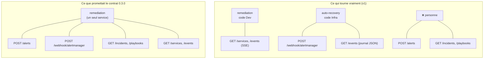
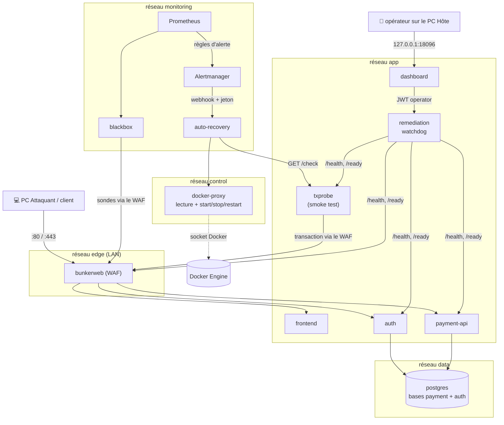
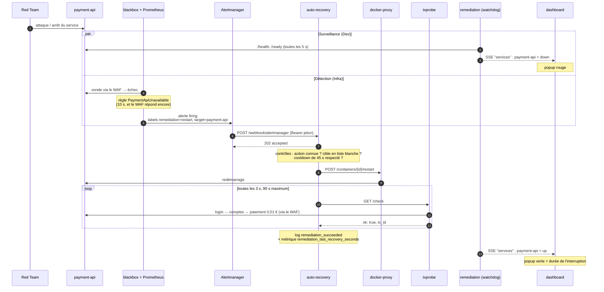
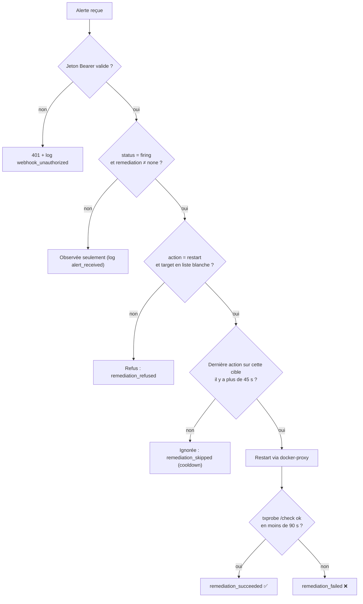

# Remédiation v1 : qui surveille, qui agit (et pourquoi le contrat a changé)

> Document d'explication pour l'équipe et pour préparer le jury.
> Décision formelle : [ADR-DEV-0007](../adr/ADR-DEV-0007-remediation-v1-supervision-action.md) ·
> Contrat : [`contracts/openapi-remediation.yaml`](../../contracts/openapi-remediation.yaml) (0.4.0)

---

## 1. Le problème en une phrase

Le contrat 0.3.0 décrivait **un seul** moteur `remediation` qui fait tout. Après le merge avec l'Infra, ce travail
est fait par **deux** services, et une partie des endpoints promis n'existe pas.

Un contrat qui annonce des endpoints absents est un piège pour les autres domaines et une faiblesse devant le
jury. On a donc choisi de **faire dire la vérité au contrat** plutôt que de coder en urgence le jour du gel.

---

## 2. L'idée clé : séparer « surveiller » et « agir »

| | `remediation` (Dev) | `auto-recovery` (Infra) |
|---|---|---|
| **Rôle** | Surveiller, montrer | Agir, prouver |
| **Déclencheur** | Boucle toutes les 5 s (watchdog) | Une alerte Alertmanager |
| **Peut redémarrer un conteneur ?** | **Non** : pas de réseau `control`, pas de jeton | **Oui** : via `docker-proxy` uniquement |
| **Sortie** | Topologie → dashboard (SSE) | Restart → transaction de preuve → logs/métriques |
| **Port publié (PC Hôte)** | `127.0.0.1:18090` | `127.0.0.1:18095` |

C'est aussi une bonne pratique de sécurité, le **moindre privilège** : le service qui parle au navigateur (le
dashboard passe par `remediation`) n'a **aucun** moyen d'agir sur Docker. Si on le compromet, on ne peut que lire
des états.

---

## 3. Architecture et réseaux

Chaque cadre est un réseau Docker. Tous sont `internal: true` (aucune sortie) sauf `edge` (le LAN de la démo) et
`mgmt` (ports admin publiés sur `127.0.0.1` seulement).

À retenir :
- **Aucune base, aucun Vault, aucun socket Docker exposé** : postgres est uniquement sur `data`, le socket n'est
  joignable qu'à travers `docker-proxy`, qui refuse `create` et `exec`.
- **La sonde de preuve passe par le WAF**, comme un vrai client : elle prouve que le service est rendu de bout en
  bout, pas seulement que le conteneur tourne.

---

## 4. Le film d'une panne : `payment-api` tombe

Deux chaînes tournent **en parallèle et indépendamment** : celle du Dev montre, celle de l'Infra répare. Si l'une
tombe, l'autre continue.

---

## 5. Les garde-fous d'`auto-recovery` (à savoir défendre)

| Garde-fou | Contre quoi |
|---|---|
| Jeton partagé avec Alertmanager seulement | N'importe qui pourrait déclencher des redémarrages |
| Liste blanche des cibles | Faire redémarrer un composant critique non prévu (ex. Prometheus) |
| Une seule action (`restart`) | Une alerte forgée qui demanderait autre chose |
| Cooldown par cible | Redémarrages en boucle pendant une attaque qui dure |
| docker-proxy sans `create`/`exec` | Prise de contrôle de l'hôte via le socket Docker |
| Preuve par transaction réelle | « Le conteneur a redémarré » n'est **pas** une preuve de reprise |
| Règle « le WAF répond encore » | Redémarrer payment-api alors que la vraie cause est le WAF |

---

## 6. Ce qui a changé dans le contrat (0.3.0 → 0.4.0)

| Élément | Avant | Maintenant |
|---|---|---|
| Description | « moteur `services/remediation` » | Tableau des deux services, rôles et ports |
| `servers` | `/` (un seul) | `http://remediation:8000` et `http://auto-recovery:8000` |
| `/webhook/alertmanager` | décrit la cible seulement | `servers` propre (auto-recovery) + comportement v1 + réponse `202` |
| `/alerts`, `/incidents`, `/playbooks` | présentés comme disponibles | `x-implementation: v2`, « non servi en v1 » |
| `/events` | — | précise : SSE de `remediation` ≠ journal JSON d'`auto-recovery` |
| `Topology.nodes[].name` | « service Compose » (faux pour 3 composants) | correspondance `auth-db`/`payment-db` → `postgres`, `smoke-test` → `txprobe` |
| Consommateurs | « IA (envoi d'alertes) » | IA retirée : elle ne remédie pas |

**Principe** : on n'a pas supprimé la cible v2 du contrat, on l'a **étiquetée**. Le contrat garde la direction
d'arrivée et dit clairement où on en est.

---

## 7. Notions à retenir

- **Contract-first** : les domaines avancent en parallèle grâce aux contrats. Un contrat faux est pire qu'un contrat
  incomplet : les autres codent contre une interface qui n'existe pas.
- **Séparation des responsabilités** : observer ≠ agir. Les deux services évoluent et tombent indépendamment.
- **Moindre privilège** : chaque service n'a que les réseaux et secrets dont il a besoin (`remediation` n'a pas
  `control`, le dashboard n'a pas `monitoring`).
- **Preuve de reprise métier** : on mesure le service rendu (une transaction), pas l'état du conteneur.
- **Idempotence et anti-boucle** : cooldown et déduplication empêchent un automate de faire plus de mal que l'attaque.
- **Fiabilité en démo > ambition** : le jour du gel, on garde la chaîne déjà testée et on documente l'écart (ADR).

---

## 8. Questions probables du jury

**« Pourquoi deux services au lieu d'un moteur ? »**
Le merge a réuni deux implémentations. Celle de l'Infra agit et a été testée de bout en bout, la nôtre surveille.
Le jour du gel, fusionner aurait été risqué. On a documenté la séparation (ADR-DEV-0007) et elle respecte le
moindre privilège.

**« Qu'est-ce qui prouve que le service est revenu ? »**
`auto-recovery` ne déclare le succès qu'après une **nouvelle transaction fictive** réussie à travers le WAF (login,
comptes, paiement de 0,01 €), avec son `tx_id` dans le log `remediation_succeeded`.

**« Et si l'attaque continue, l'automate redémarre en boucle ? »**
Non : il y a un cooldown de 45 s par cible, Alertmanager regroupe les alertes, et les règles d'inhibition
(`WafDown`, `PostgresDown`) évitent de redémarrer un service sain quand la cause est ailleurs.

**« Un attaquant peut-il déclencher des remédiations ? »**
Il lui faudrait le jeton du webhook, qui n'est partagé qu'avec Alertmanager et fourni par Vault en secret Docker.
Même avec ce jeton, il ne pourrait que redémarrer une cible de la liste blanche.

**« Qu'est-ce qui manque ? »**
La v2 : le watchdog qui envoie ses propres alertes, des objets `Incident` visibles sur le dashboard, et une table
de playbooks par type d'incident (blocage d'IP au WAF, restauration de base).

---

## 9. Pendant la démo : quoi montrer

1. **Dashboard** (`127.0.0.1:18096`) : la topologie passe au rouge, puis au vert avec la durée d'interruption.
2. **Grafana** (`127.0.0.1:3000`), ou `GET 127.0.0.1:18095/events` : les étapes `remediation_started` →
   `remediation_succeeded`, avec le `tx_id` de la transaction de preuve.
3. **Le dashboard ne montre pas encore les actions de remédiation** : il faut montrer les deux écrans.

---

## 10. Reste à faire / à demander

| À qui | Quoi |
|---|---|
| Infra + Cyber | Créer `contracts/network.md` (ports publiés, réseaux, flux autorisés), référencé partout mais absent |
| Infra | Relire la PR du contrat 0.4.0 ; décider qui maintient `services/auto-recovery/` |
| Dev (v2, après le jury) | Fusionner : watchdog → alertes `source: watchdog` → moteur avec `Incident`/`Playbook` → SSE `incident` |
